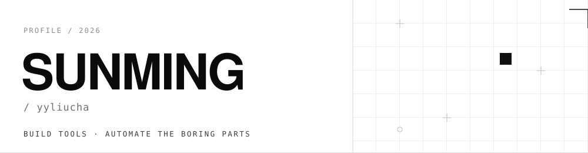

  <picture>
    <source media="(prefers-color-scheme: dark)" srcset="assets/hero-dark.svg">
    
  </picture>

把重复的事交给机器

---

### 01 · 关于

写后端，也写工具。喜欢把日常里重复的动作先拆成脚本，再打磨成能一直跑下去的东西——自动播完就切下一集的课、凌晨自动比价并记下价格曲线的游戏，都是这么来的。

比起一口气写完，更在意能不能长期维护：结构化日志、容器化、失败可重试。让工具留下来，而不是烂在硬盘里。

- **产品化** — 后端、插件、桌面工具，从零做到能跑
- **自动化** — 采集、定时任务、批处理，把人工步骤压到零
- **工程化** — Docker、数据迁移、日志，让脚本活过三个月

---

### 02 · 精选项目

**[steamdeals](https://github.com/yyliucha/steamdeals)** · 中文游戏的价格履历

官方渠道比价 + 价格历史。PostgreSQL 15 存数据，Docker 起服务，日志结构化。目前可直接采集的源是杉果；Steam 需要网络出口，ITAD 需要 API key。

`Node.js` `PostgreSQL` `Docker`

**[plugin-important-dates](https://github.com/yyliucha/plugin-important-dates)** · 记得：纪念日与爱车

Halo 2.x 插件。记纪念日、生日（阳历/农历），顺带管座驾：保险、年检、车船税到期提醒，年检按登记日期和车型规则自动推算。多图相册在附件被删时自动降级，不裂图。

`Java` `Vue` `Halo 2.x`

---

### 03 · 其他项目

| 项目 | 一句话 |
| :--- | :--- |
| [yylcha.pub](https://github.com/yyliucha/yylcha.pub) | C# 桌面工具箱：批量解压、NuGet 上传、git / svn 取码 |
| [pixabay-downloader](https://github.com/yyliucha/pixabay-downloader) | Pixabay 批量下载：全局去重 + 定时任务，Docker 一条命令起 |
| [halo-pixabay-plugin](https://github.com/yyliucha/halo-pixabay-plugin) | 定时把 Pixabay 图片灌进 Halo 附件库，按关键词归档 |
| [learning-auto-player](https://github.com/yyliucha/learning-auto-player) | 在线学习自动播放：防暂停、自动签到、播完切集（[demo](https://yyliucha.github.io/learning-auto-player/)） |
| [yylcha.smoothSignature](https://github.com/yyliucha/yylcha.smoothSignature) | smoothsignature 签名实现 |
| [QR.github.io](https://github.com/yyliucha/QR.github.io) | 二维码小页面 |

---

### 04 · 技术栈

| 分类 | 内容 |
| :--- | :--- |
| 语言 | C# · Java · JavaScript · Python |
| 数据 | PostgreSQL |
| 容器 | Docker · Docker Compose |
| 平台 | Halo 2.x 插件 · WPF · Playwright |

---

### 05 · 联系

问题、建议、想一起做的，直接在对应仓库开 issue——写清场景和复现步骤，我大概率会回。

SUNMING / yyliucha · 用 Markdown 和一点强迫症搭的

