  

<h1 align="center">Hi 👋 我是 sunming</h1>

  <b>后端 · 工具 · 自动化</b> 
  把重复的事交给机器，再让它一直跑下去

  &nbsp;&nbsp;
  &nbsp;&nbsp;
  

## 🧭 关于我

- 🔭 **现在在做** —— [steamdeals](https://github.com/yyliucha/steamdeals)：中文游戏的价格履历，官方渠道比价 + 价格历史
- ✍️ **在写** —— [YのBlog](https://blog.yyliucha.cn)：Windows 运维排查、AI 编程工具实战、开源折腾
- 🌱 **在折腾** —— Halo 2.x 插件生态（Java + Vue），把自用脚本做成能长期跑的服务
- 🧰 **日常工具** —— C#/.NET · Java · Node.js · Python · PostgreSQL · Docker
- 💬 **可以问我** —— 数据采集与定时任务、插件开发、Windows 桌面小工具
- 📫 **找到我** —— 在任意仓库开 issue，说清场景和复现步骤

## 🚀 精选项目

**[steamdeals](https://github.com/yyliucha/steamdeals)** · 中文游戏的价格履历

官方渠道比价 + 价格历史。PostgreSQL 15 存数据，Docker 起服务，日志结构化。目前可直接采集的源是杉果；Steam 需要网络出口，ITAD 需要 API key。

`Node.js` `PostgreSQL` `Docker`

**[plugin-important-dates](https://github.com/yyliucha/plugin-important-dates)** · 记得：纪念日与爱车

Halo 2.x 插件。记纪念日、生日（阳历/农历），顺带管座驾：保险、年检、车船税到期提醒——年检按登记日期和车型规则自动推算。多图相册在附件被删时自动降级，不裂图。

`Java` `Vue` `Halo 2.x` `Gradle`

**[learning-auto-player](https://github.com/yyliucha/learning-auto-player)** · 在线学习自动播放器

防暂停、自动续播、自动签到、播完自动切下一集、多门课自动遍历。书签一键注入和本地真实浏览器（Playwright）两条路径，纯前端零后端。 [在线试用 →](https://yyliucha.github.io/learning-auto-player/)

`JavaScript` `Playwright` `Tampermonkey`

## 📦 其他项目

| 项目 | 一句话 |
| :--- | :--- |
| [yylcha.pub](https://github.com/yyliucha/yylcha.pub) | C# 桌面工具箱：批量解压、NuGet 上传、git / svn 取码 |
| [pixabay-downloader](https://github.com/yyliucha/pixabay-downloader) | Pixabay 批量下载：全局去重 + 定时任务，Docker 一条命令起 |
| [halo-pixabay-plugin](https://github.com/yyliucha/halo-pixabay-plugin) | 定时把 Pixabay 图片灌进 Halo 附件库，按关键词归档 |
| [yylcha.smoothSignature](https://github.com/yyliucha/yylcha.smoothSignature) | smoothsignature 签名实现 |
| [QR.github.io](https://github.com/yyliucha/QR.github.io) | 二维码小页面 |

## 🛠 技术栈

**语言**

   

**数据 · 容器**

  

**平台 · 框架**

   

## 🧠 做事的偏好

1. **能自动化就别手工** —— 同一件事做第二遍，就该写脚本
2. **先能跑，再收拾** —— 能用的 80 分，胜过完美的 0 分
3. **让工具活下来** —— 日志、容器、可重试，决定它是玩具还是产品

## 🤝 联系

- **博客** —— [blog.yyliucha.cn](https://blog.yyliucha.cn)：Windows 运维排查、AI 编程工具实战、开源折腾
- **邮箱** —— 见上方 EMAIL 徽章（已转成图片，防爬虫抓取）
- **公众号** —— 爆抱琪，微信搜索即可关注
- **Issue** —— 问题、建议、想一起做的，直接在对应仓库开 issue，写清场景和复现步骤，我大概率会回

SUNMING / yyliucha · 用 Markdown 和一点强迫症搭的

